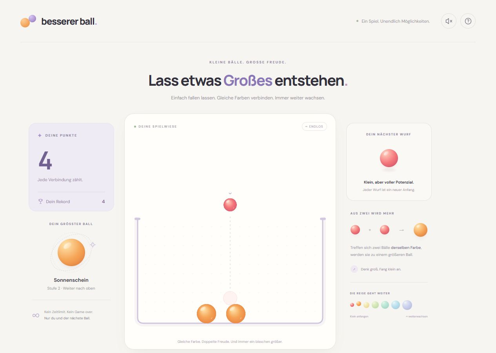

# Besserer Ball

Ein endloses Browser-Spiel mit **PixiJS 8** und **Matter.js**. Gleiche Farben verschmelzen zu größeren Bällen. Jeder neue Wurf ist der kleinste rote Ball. Es gibt keine letzte Stufe und kein Game over: Wenn der Platz knapp wird, wächst die Wanne und die Ansicht zoomt heraus.

**[Jetzt im Browser spielen](https://smeraner.github.io/BessererBall/)** · [GitHub-Projekt](https://github.com/smeraner/BessererBall)



## Lokal starten

Voraussetzung: Node.js ab Version 22.12.

```powershell
cd D:\Projekte\BessererBall
npm install
npm run dev
```

Dann die im Terminal angezeigte Adresse öffnen, normalerweise **http://localhost:5173**. Alternativ unter Windows `Starten.cmd` doppelklicken. Das Startfenster bleibt geöffnet, solange der Server läuft; Strg+C beendet ihn.

Auf dem Smartphone im selben WLAN die unter `Network` angezeigte Adresse verwenden. Gegebenenfalls muss der lokale Node.js-Server in der Windows-Firewall für das private Netzwerk erlaubt werden.

## Steuerung

| Aktion | Bedienung |
| --- | --- |
| Zielen | Pfeiltasten links/rechts, Maus oder Finger |
| Abwerfen | Ins Spielfeld tippen/klicken, ziehen und loslassen, Leertaste oder „Ball abwerfen“ |
| Pause | P oder Pause-Knopf |
| Neustart | Neustart-Knopf und im Dialog bestätigen |
| Ton | Lautsprecher oben rechts; standardmäßig aus |
| Anleitung | Fragezeichen oben rechts |

## Spielregeln

- Zwei Bälle derselben Farbe ergeben einen Ball der nächsten Stufe. Die Farben wiederholen sich auch nach den ersten Stufen nicht zyklisch.
- Die Fläche des neuen Balls entspricht der Summe der beiden alten Kreisflächen. Der Radius wächst deshalb jeweils um den Faktor √2.
- Masse und linearer Impuls werden bei der Verschmelzung übernommen. Matter.js simuliert Schwerkraft, Rotation, Reibung, Kollisionen und das Abprallen. Die Simulation läuft mit festen Schritten von 1/120 Sekunde.
- Eine Verschmelzung zu Stufe 2 bringt 2 Punkte, zu Stufe 3 bringt 4 Punkte usw. Punkte verwenden `BigInt`.
- Der Punkterekord und die Toneinstellung bleiben lokal in diesem Browser erhalten. Ein Neustart löscht den Rekord nicht. Der laufende Spielstand wird beim Neuladen zurückgesetzt.
- Neue Bälle lassen sich alle 280 Millisekunden abwerfen. Pause, Dialoge und ein ausgeblendeter Browser-Tab unterbrechen die Simulation.
- Der Behälter wächst bei Platzbedarf; vorhandene Bälle behalten ihre Größe in der Physikwelt. Die Ansicht passt sich an. Es werden keine Bälle wegen Überfüllung entfernt.

## Prüfen und bauen

```powershell
npm test
npm run build
npm run preview
```

`npm test` prüft echte Physiksimulationen einschließlich Verschmelzungen, Kettenreaktionen, Massenerhaltung, Begrenzung, Wachstum und Neustart. `npm run build` erzeugt die fertige statische Anwendung in `dist/`. Diese Dateien können über einen beliebigen statischen Webserver ausgeliefert werden; `index.html` nicht direkt per Doppelklick öffnen.

Schriftarten und Bibliotheken werden mit der Anwendung gebündelt. Nach der Installation benötigt das laufende Spiel keine externen Dienste, Konten oder API-Schlüssel. Die erste Installation benötigt Internet. Ein aktueller Browser mit WebGL ist erforderlich.

## GitHub Pages

Das Spiel wird unter **https://smeraner.github.io/BessererBall/** veröffentlicht. Jeder Push auf `main` startet den Workflow `.github/workflows/pages.yml`: Er installiert die festgeschriebenen Abhängigkeiten, führt die Physiktests aus, baut die statische Website und veröffentlicht `dist/` auf GitHub Pages. Der Workflow kann unter **Actions** auch manuell gestartet werden.

Unter **Settings → Pages → Build and deployment** ist **GitHub Actions** als Quelle eingestellt. `vite.config.js` verwendet relative Asset-Pfade, damit JavaScript, Schriftarten und Bilder auch unter dem Unterpfad `/BessererBall/` geladen werden.

## Dateien

- `src/main.js`: Oberfläche, Eingaben, Rekord und Spielablauf
- `src/physics.js`: Matter.js-Simulation und Regeln
- `src/view.js`: PixiJS-Darstellung, Glanztexturen, Zielhilfe und Effekte
- `src/audio.js`: dezente, lokal erzeugte Web-Audio-Klänge
- `src/style.css`: responsive Oberfläche und reduzierte Animationen
- `test/physics.test.js`: automatisierte Physiktests

Technische Referenzen: [PixiJS Application](https://pixijs.com/8.x/guides/components/application), [Matter.js Engine](https://brm.io/matter-js/docs/classes/Engine.html).
